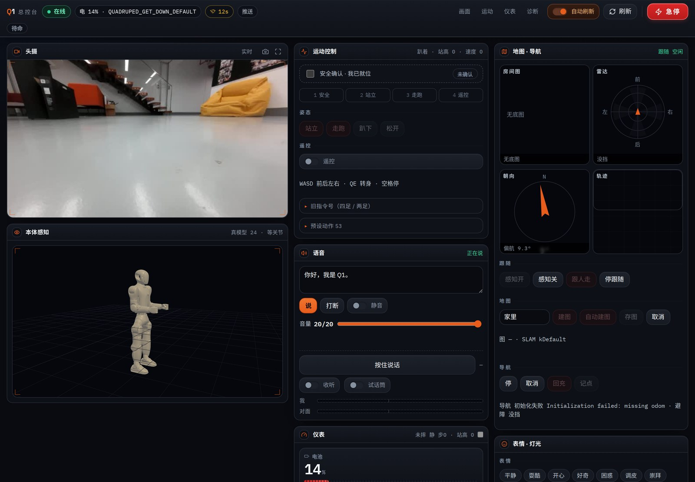
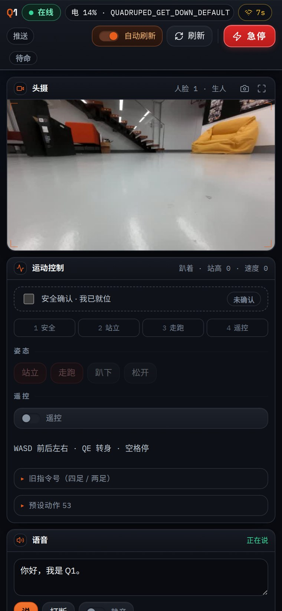
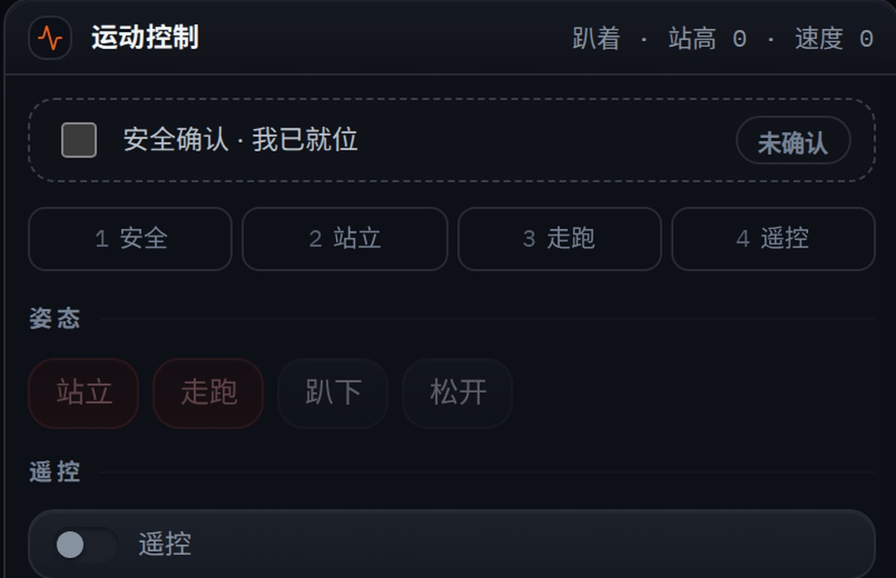

# Q1 Console

一块给**启元 Q1 人形机器人**用的网页控制台。浏览器打开就能看头摄直播、读实时遥测、发语音、点按钮让它动。



后来也接到了**启元 T1 机器狗**上——所以里面有一层「机型适配」的开关，见 [机型差异](#机型差异)。

> ⚠️ 这是给自己队伍用的小工具，不是产品。里面**没有任何认证**，默认监听 `0.0.0.0:8788`，只该跑在你自己的内网/单机上。

---

## 它长什么样

一个页面，从上到下：

- **实时** — 头摄画面、电池/姿态/速度、当前动作、上身关节、CPU 负载
- **直播** — 低延迟视频流
- **指标** — 历史曲线
- **数据** — 原始话题
- **说话** — 打字让它用机器人的喇叭念出来（TTS），也能听机器人麦克风
- **动作** — 机器人自己上报的预设动作列表 + 连续动作
- **驾驶** — 按住才走的方向盘（松手即停）

### 手机上

头摄和运动控制被有意排在同一屏——你在动它的时候必须一直看得见它。左边是 3D 姿态孪生，右边是实时仪表。

<p>

</p>

### 安全闸

运动区最上面那个勾选框不是装饰。不勾，所有会动的按钮都是灰的；就算绕过前端直接发请求，后端也会再校验一次。



---

## 怎么跑

### 1. 这台电脑需要

```bash
python3 -m pip install fastapi uvicorn pydantic anyio
```

外加两个命令行工具：

- `ssh` / `sshpass` — 连机器人
- `ffmpeg` — 把机器人的 RTSP 流转成网页能显示的 JPEG

### 2. 填配置

```bash
cp .env.example .env
$EDITOR .env
```

最少要填 `Q1_HOST` 和 `Q1_PASS`。**`.env` 里有明文密码，别提交、别截图。**

### 3. 起服务

```bash
python3 server.py     # 监听 :8788
```

或者做成开机自启（用户级 systemd，不需要 sudo）：

```ini
# ~/.config/systemd/user/q1-console.service
[Unit]
Description=Q1 console
After=network-online.target

[Service]
WorkingDirectory=/path/to/q1-console
ExecStart=/usr/bin/python3 /path/to/q1-console/server.py
Restart=on-failure
RestartSec=3

[Install]
WantedBy=default.target
```

```bash
systemctl --user daemon-reload
systemctl --user enable --now q1-console
```

### 4. 打开

```
http://127.0.0.1:8788
```

---

## 架构

```
浏览器 ──HTTP/WS──> server.py (:8788) ──SSH──> 机器人
                      │
                      └──HTTP──> live_daemon.py (:8799)   ← 也跑在机器人上
```

这台电脑上只有 `server.py`。它在启动时用 SSH 把其余几个文件**推送到机器人上**，然后长期跑着：

| 文件 | 跑在哪 | 干什么 |
|---|---|---|
| `server.py` | 本机 | FastAPI，页面 + 所有 `/api/*`。SSH 命令都从这里发 |
| `live_daemon.py` | 机器人 | 常驻 ROS 2 节点，把十几个话题缓存成一份快照，`:8799/live` 直接返回，永不阻塞 |
| `live_probe.py` | 机器人 | 探索用：订阅各话题看谁有数据、QoS 兼容不兼容 |
| `mic_pump.py` | 机器人 | 独立进程的麦克风泵。**分进程是有原因的**，见它自己的文件头注释 |
| `cmd_loop.py` | 机器人 | 常驻命令节点，从 stdin 收 `SAY` / `VOL` / `ACTION` 等短指令 |
| `drive_loop.py` | 机器人 | 按住才发的速度发布器，有 0.4 秒死手开关 |
| `people.py` | 本机 | 本地人脸小册子，认不出的脸先存下来以后起名 |
| `bake_urdf.py` | 本机 | 一次性脚本：把 URDF 的视觉网格烘成碰撞体，机器人上没有 STL |
| `tools_bump.py` | 本机 | 改了 `live_daemon.py` 必须跑它，否则改动会**静默不生效** |
| `tools_usb_scan.py` | 本机 | 机器人直连时不知道它在哪个地址，用它扫 |

### 为什么机器人上还要有个守护进程

直接 SSH 跑 `ros2 topic echo` 太慢了——每条命令要重新拉起一个 ROS 2 节点，话题一多就卡死。所以 `live_daemon.py` 常驻在机器人上，订阅一遍，把最新值攒成一个 JSON 快照。本机 `server.py` 每 0.08 秒拉一次，页面永远拿到的是**已经准备好的**数据，不会阻塞。

### 改动守护进程之后

`live_daemon.py` 有版本号，`server.py` 比对版本号决定要不要重新推送。改了代码不 bump 版本，机器人上跑的还是旧的，而且**不会报错**：

```bash
python3 tools_bump.py
```

---

## 安全设计

这不是玩具，动起来的是一台几十公斤、会自己走路的真机。控制台里有两道闸，**别拆**：

1. **「安全确认 · 我已就位」勾选框** — 不勾，所有会动的按钮都是 disabled。发出去的每个运动指令都带 `watch` 标志，后端再校验一次，前端绕过也没用。
2. **急停** — 任何时刻可点，优先级高于一切。

另外：

- **驾驶是按住才走**。松手、切标签页、断网，`drive_loop.py` 的 0.4 秒死手开关会让机器人自己停下。
- 页面上的**预设动作列表是运行时跟机器人要的**（`GetMotionList`），不是写死的——所以换机型不会把 A 机器人的动作发到 B 机器人上。

---

## 机型差异

控制台最初是按 **Q1（人形，22 自由度）** 写的，后来接上了 **T1（四足机器狗）**。能通用的部分自动通用，不能的要改：

| | Q1 | T1 |
|---|---|---|
| 头摄 | 单目 1280×720，RTSP 路径 `live_head_monocular_centra` | 左右目各 640×480 @10fps，`live_head_stereo_left` / `_right` |
| 关节数据 | 走 ROS 2，能直接读 | 默认走 **iceoryx** 共享内存，ROS 2 侧看不见；要读得开 `MC_LOW_LEVEL_DEV=true` 并重启 |
| 运动语义 | 人形步态 | 四足 RL 策略，动作 id 完全不同 |

**RTSP 路径写错的表现很有欺骗性**：ffmpeg 拿到 404，画面会**冻在最后一帧**，看起来像摄像头坏了而不是路径错了。判断方法——连拍两张，字节完全一样就是死帧。

用 `Q1_RTSP_PATH` 切换。

---

## 排查

| 症状 | 先看这里 |
|---|---|
| 页面能开，数据全是空的 | `curl 127.0.0.1:8788/api/health`，看 `online` 和 `live_source` |
| 头摄画面不动 | 两张快照 md5 一样 = 死帧。检查 `Q1_RTSP_PATH` 和 RTSP 2554 通不通 |
| 改了守护进程没反应 | 跑 `tools_bump.py` 了吗 |
| 机器人连不上 | `tools_usb_scan.py`。它用的是静态 IP，**不跑 DHCP** |

---

## 授权

内部自用代码，未附授权协议。里面 `static/urdf/q1/` 的模型文件来自机器人厂商，版权归厂商所有。
